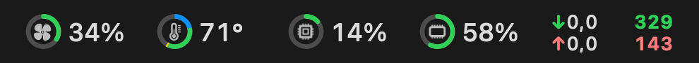
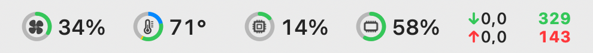
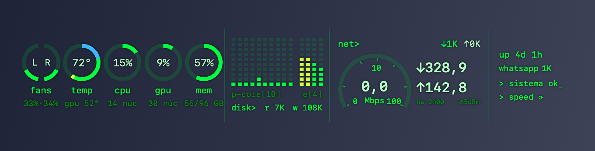
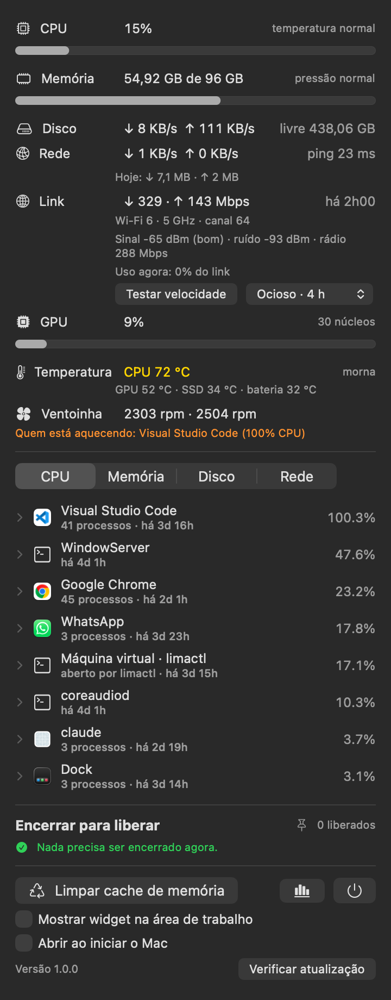

<p align="center"></p>

# ePerformance View

App leve para macOS que mostra, de forma simples, **quem está usando CPU, memória, disco e rede**, a **temperatura**, o que está **ligando a ventoinha** e a **velocidade da internet**, direto na barra de menus e num widget na área de trabalho.

Também identifica apps parados que podem ser fechados para liberar memória e diz qual app está por trás de processos com nome técnico (ex.: "com.apple.Virtualization.VirtualMachine" → Docker/Colima).

## Barra de menus




Ventoinha, CPU e memória com anéis verde/amarelo/vermelho, e a temperatura num anel de frio a calor (azul → verde → amarelo → vermelho). Ao lado, a internet: **↓ download** e **↑ upload** agora (Mbps) e, à direita, a velocidade do último teste. O círculo com número aparece quando há app sugerido para fechar.

## Widget na área de trabalho



- **fans**: as duas ventoinhas (L e R) num anel dividido
- **temp**: núcleo mais quente da CPU, de frio a calor, e a GPU embaixo
- **cpu / gpu / mem**: uso atual
- **núcleos**: cada núcleo de performance e de eficiência, e o disco (leitura e escrita)
- **net**: velocímetro de Mbps agora e o resultado do último teste (↓ / ↑)
- **status**: tempo ligado, app que mais usa a rede, `> sistema ok_` ou o app a encerrar, e `> speed ⟳` para medir a internet na hora

## Painel



Clique nos indicadores da barra de menus para abrir. Lista os apps por CPU, memória, disco ou rede, com os processos de cada um, quem os abriu e há quanto tempo. Permite marcar apps que podem ficar sempre abertos.

## Instalar

1. Baixe [**ePerformanceView.zip**](https://github.com/elisoares/ePerformanceView/releases/latest/download/ePerformanceView.zip) da última versão.
2. Descompacte e arraste **ePerformance View.app** para **Aplicativos**.
3. Na primeira vez, clique com o botão direito no app → **Abrir** → **Abrir**. O app não é assinado por um desenvolvedor da Apple, então o macOS pede essa confirmação uma única vez.

Ou pelo Terminal:

```bash
curl -L -o /tmp/ePerformanceView.zip https://github.com/elisoares/ePerformanceView/releases/latest/download/ePerformanceView.zip && ditto -x -k /tmp/ePerformanceView.zip /Applications && open "/Applications/ePerformance View.app"
```

Requer macOS 13 ou mais novo.

## Atualizar

O app verifica uma vez por dia se há versão nova no GitHub. Quando houver, aparece **Atualizar para X.Y.Z** no rodapé do painel: um clique baixa, troca o app e reabre. Também dá para clicar em **Verificar atualização** a qualquer momento.

A verificação só lê a página pública de versões do repositório; nada sobre o seu Mac é enviado.

## Uso de recursos

Cerca de 2–3% de CPU e ~100 MB de memória. O teste de velocidade (o `networkQuality` da Apple) não roda sem parar: por padrão ele roda sozinho só depois de 10 minutos sem teclado e mouse, na tomada, com a internet parada e no máximo 1× a cada 4 horas.

## Compilar

```bash
./build.sh
```

Gera `build.noindex/ePerformance View.app` (pasta ignorada pelo Spotlight e pelo Launchpad). Precisa das ferramentas de linha de comando do Xcode (Swift 5.9+).

## Publicar uma versão nova

1. Altere o número em `VERSION` (ex.: `1.1.0`).
2. Rode:

```bash
./release.sh "o que mudou"
```

O script compila, gera `ePerformanceView.zip` e cria a release `v1.1.0` no GitHub (precisa do [gh](https://cli.github.com) logado). Os apps instalados passam a oferecer a atualização.
